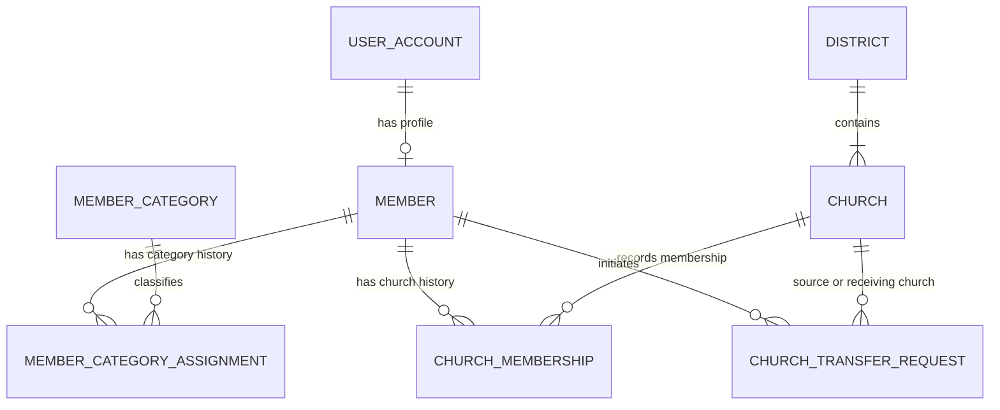
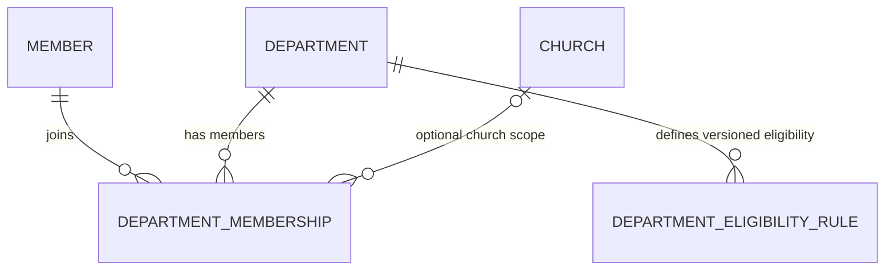
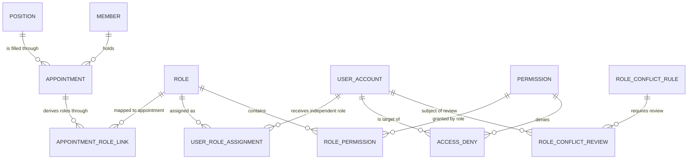
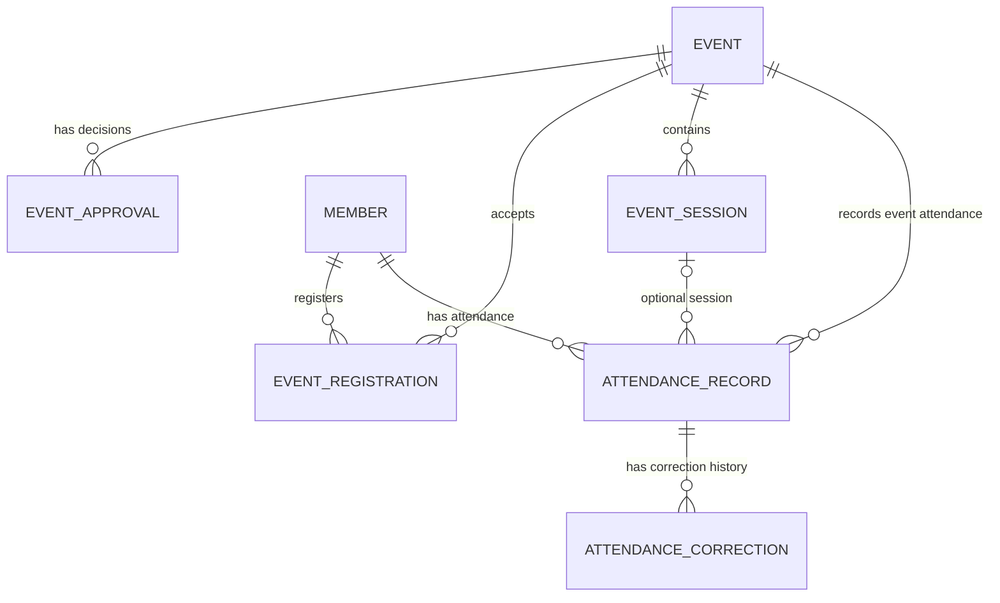
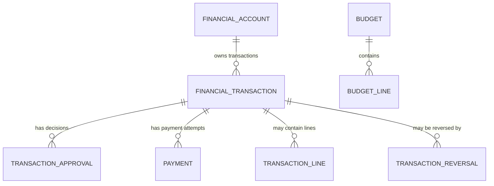
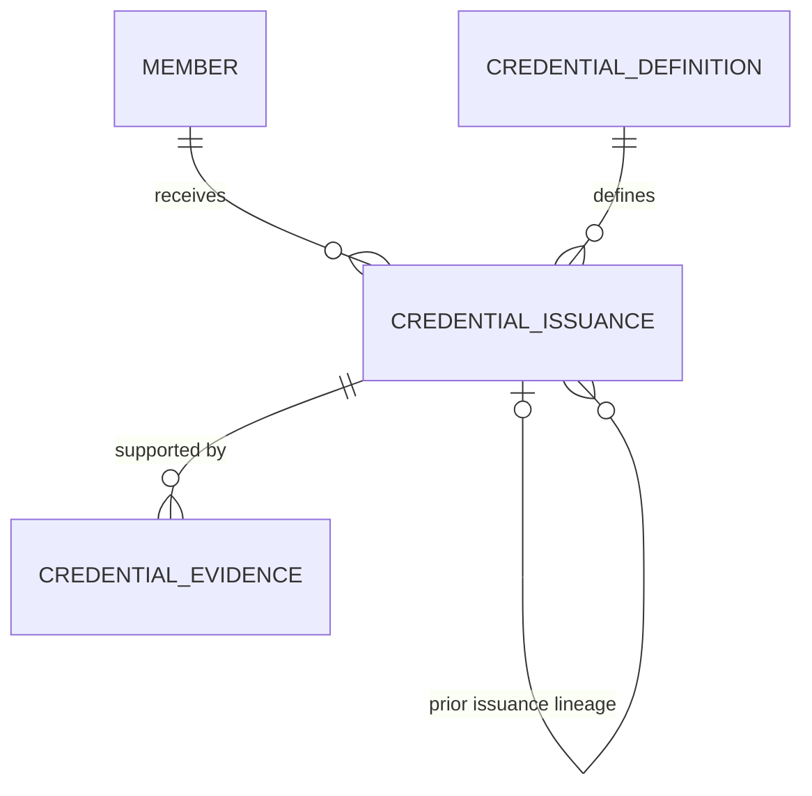
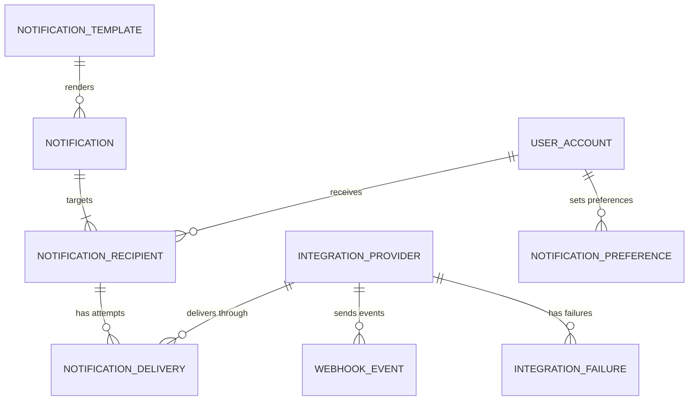
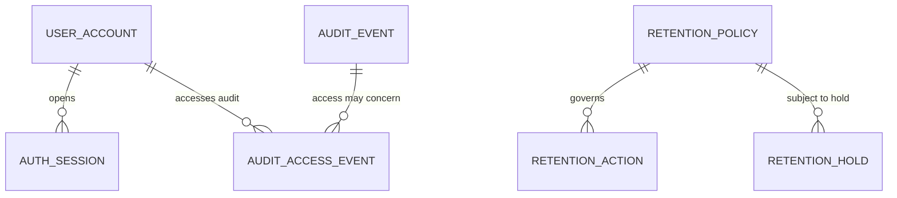

# DYMS Phase 1 Conceptual ERD Diagrams

**Status:** Visual companion to the conceptual ERD. Working review artifact only.  
**Scope:** DYMS v1.0, Sango District.  
**Implementation:** Not authorized. These diagrams are logical relationship views, not physical database schema.

The diagrams show principal relationships. The authoritative candidate attributes, constraints, assumptions, policy gaps, and integrity refinements remain in [PHASE-1-CONCEPTUAL-ERD.md](./PHASE-1-CONCEPTUAL-ERD.md).

## 1. Identity, member category, and church

Cardinality interpretation: each MEMBER must link to exactly one USER_ACCOUNT. A USER_ACCOUNT may exist before a MEMBER profile is created, and may link to at most one MEMBER. The member's current primary church is one active CHURCH_MEMBERSHIP; historical memberships remain retained.

## 2. Department membership

Department membership does not grant leadership authority. Eligibility rules are placeholders until official requirements are confirmed.

## 3. Leadership and authorization

Position, appointment, role, and permission are separate concepts. An appointment grants no implicit permissions. Explicit deny applies only to its named permission and scope.

## 4. Events, registration, and attendance

Attendance is either event-level or session-level for a given event and member. The final physical design must prevent double-counting across these modes. Registration prerequisite remains a policy question.

## 5. Finance

Each account has one organizational owner and one currency. Partial payments, accounting sign convention, budget enforcement, and partial reversal policy remain unresolved.

## 6. Credentials

Credential definitions are versioned. Issuance, renewal, revocation, correction, and reissue preserve lineage. Qualification requirements and issuer authority must come from an approved governing source.

## 7. Notifications and external integrations

Notification retries and webhook processing must be idempotent. Provider acceptance is not proof of delivery. Provider secrets are stored outside ordinary database records.

## 8. Audit, idempotency, and retention

AUDIT_EVENT, IDEMPOTENCY_RECORD, RETENTION_POLICY, RETENTION_HOLD, and RETENTION_ACTION have cross-domain relationships. Some use conceptual target references; physical design must enforce valid targets. Retention periods are not invented, and a valid hold blocks covered destructive actions.

## 9. Cross-domain principles

- Every member has one individual account. No guardian-managed or delegated login relationship exists.
- Member category, department membership, appointment, role, and credential are distinct.
- Every scoped permission and business record must have a valid organizational scope.
- Historical assignments and decisions are preserved.
- Sensitive state changes are auditable and idempotent.
- Finance, attendance, transfer, appointment, and credential workflows require atomic integrity.
- Reporting consumes authoritative records and rechecks authorization.
- These diagrams do not approve physical table names, columns, indexes, constraints, Prisma models, or migrations.
