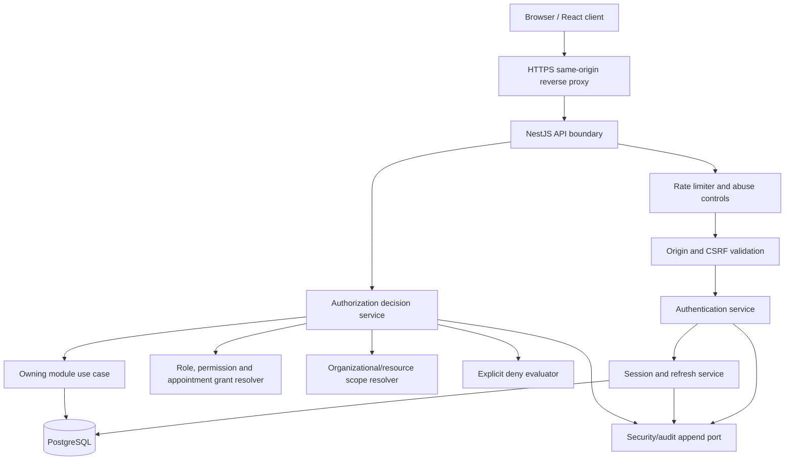
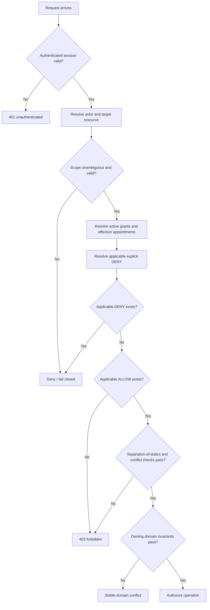

# DYMS Phase 3 — Authentication and Authorization Architecture

- Revision: AAA-01
- Date: 2026-11-02
- Scope: DYMS v1.0, Sango District
- Status: **DETAILED SECURITY DESIGN PROPOSAL**
- Governing decisions: DFR-001, DFR-004, DDD-005, DDD-013 and approved ODR-010 default
- Implementation: **NOT AUTHORIZED**

## 1. Purpose and precedence

This document translates the frozen authentication decisions and approved authorization principles into a component design. Where a detail is already frozen, this document preserves it. Where a catalogue or policy remains open, this document marks it as a proposal or dependency.

Precedence:
1. DFR-001–DFR-006.
2. Approved DDD decisions and recorded clarifications.
3. Owner Decision Register and its authority gates.
4. This design proposal.
5. Later implementation details, only after formal approval.

No design here changes the individual-account rule. Each member has one individual user account linked one-to-one with one member record. Guardian accounts, shared credentials and delegated guardian-to-child login are prohibited.

## 2. Security objectives

- Authenticate the account holder and validate a server-side session on every protected request.
- Deny access by default.
- Enforce permissions and organizational scope on the server.
- Give explicit DENY precedence over applicable ALLOW.
- Prevent self-approval, self-grant and separation-of-duties violations.
- Expire appointment-derived access when the appointment ends.
- Prevent cross-church and cross-department scope leakage.
- Protect authentication endpoints from brute force, credential stuffing, replay and enumeration.
- Preserve auditable security decisions without logging credentials or secrets.
- Apply rate limiting to public and authenticated APIs.

## 3. Component architecture

## 4. Frozen authentication contract

| Control | Approved value |
|---|---|
| Password hashing | Argon2id |
| Access credential lifetime | 15 minutes |
| Session inactivity timeout | 7 days |
| Absolute session lifetime | 30 days |
| Refresh credential | Rotating, server-side validated |
| Browser cookie | Secure, HttpOnly, host-only, SameSite=Lax |
| Access cookie path | `/api/v1` |
| Refresh cookie path | `/api/v1/auth` |
| CSRF | Session-bound synchronizer token and origin validation |
| CORS | Explicit allowlist |
| Production topology | Same-origin HTTPS reverse proxy |
| Password reset | Single-use token, 30-minute lifetime |
| Refresh reuse | Detect and apply defined revocation behavior |
| Logout | Per-session revocation and logout from all devices |
| Password reset/account suspension | Invalidate sessions as specified in DFR-004 |
| Rate limiting | Mandatory; include brute-force protection |
| Browser storage | No long-lived auth tokens in localStorage/sessionStorage |

Refresh rotation must be atomic. The frontend must coordinate refresh attempts to avoid concurrent refresh races. The server remains authoritative; client coordination is not a security boundary.

## 5. Authentication flows

### 5.1 Login

1. Apply IP/network and account-identifier rate limits before expensive password verification.
2. Normalize the submitted account identifier using the approved canonicalization rule.
3. Use a uniform failure response that does not reveal whether an account exists.
4. Load the account and verify the Argon2id password hash.
5. Check account status and authentication restrictions.
6. Create a server-side session with inactivity and absolute expiry.
7. Issue short-lived access and rotating refresh cookies with the frozen attributes.
8. Create security audit evidence without recording password, cookie or token values.
9. Return the minimum account/member bootstrap data needed by the client.

Account activation, suspension, closure and reinstatement lifecycle values remain subject to the lifecycle catalogue and security authority. Do not infer an account state transition from a successful password comparison.

### 5.2 Protected request

1. Validate request origin and CSRF requirement.
2. Validate access credential signature/claims and expiry.
3. Resolve the server-side session and ensure it is active, not revoked, not idle-expired and not absolutely expired.
4. Resolve the authenticated user account and one-to-one member link where member identity is required.
5. Build an immutable request actor context.
6. Pass the actor context to authorization and the owning use case.
7. Record security-sensitive allow/deny outcomes under the audit policy.

### 5.3 Refresh rotation

1. Apply dedicated refresh rate limits.
2. Validate origin and CSRF.
3. Resolve the refresh credential to a server-side session.
4. Verify session inactivity and absolute expiry.
5. Atomically consume the current refresh credential and issue its successor.
6. Detect reuse of a consumed credential.
7. On reuse, apply the frozen revocation behavior, invalidate the affected session family as defined by DFR-004, and record a security event.
8. Never extend beyond the original absolute session expiry.

A failed or ambiguous rotation must not issue two valid successors. Exact token-family storage and transaction constraints require physical review.

### 5.4 Password reset

1. Apply rate limits and uniform response behavior.
2. Accept the account identifier without confirming account existence.
3. Create a single-use reset token only through the approved authentication workflow.
4. Persist the reset workflow and durable outbox reference atomically.
5. Keep the raw delivery secret only in the protected short-lived external secret store specified by D13-PDR-01.
6. Deliver through an approved channel; never put the raw secret in the outbox, queue, logs, traces or audit payload.
7. On successful reset, consume the token, update the password hash and revoke sessions according to DFR-004.
8. Reject token replay and expiry.

Provider choice and secret-store vendor remain open. The 30-minute token lifetime is frozen.

### 5.5 Logout and revocation

- Logout revokes the current server-side session and clears cookies.
- Logout from all devices revokes every active session for the account.
- Password reset and account suspension invalidate sessions as approved.
- Appointment expiry removes only appointment-derived permissions; it does not deactivate the member account.
- Revocation must take effect on the next protected request, subject only to the approved access-credential validation design.

## 6. Authorization model

### 6.1 Decision inputs

Every authorization decision is evaluated against:

- authenticated user account;
- active server-side session;
- linked member identity, when applicable;
- requested action/permission;
- target resource and resource owner;
- organizational scope (district, church, department or resource-specific);
- active independent role grants;
- effective appointment-derived grants;
- explicit DENY rules;
- role-conflict restrictions and independent review;
- separation-of-duties constraints;
- resource lifecycle state and business-specific rules.

A role title alone never grants access. A client-provided role, scope, church ID or department ID is never trusted as proof of authority.

### 6.2 Evaluation sequence

### 6.3 Decision algorithm

The proposed deterministic algorithm:

1. Reject unauthenticated or invalid sessions.
2. Resolve the resource and its authoritative owner/scope server-side.
3. Reject unknown, mismatched or ambiguous scope.
4. Resolve only active grants valid at the decision time.
5. Include appointment-derived grants only where the appointment is effective.
6. Find all explicit DENY records applicable to the exact permission and resource scope. If any applies, deny.
7. Find applicable ALLOW grants within their explicit scope. If none applies, deny.
8. Evaluate prohibited/review-required role combinations.
9. Evaluate actor separation-of-duties rules, including self-approval/self-grant prohibition.
10. Pass the decision and actor context to the owning domain use case, which enforces lifecycle and business invariants.

No implicit inheritance is assumed. Descendant-scope coverage applies only where a permission's approved scope definition explicitly states it. A deny does not spread to unrelated scopes.

### 6.4 Role and grant sources

Keep these grant sources distinct:

- Appointment-derived grant: derived from an approved, effective appointment.
- Independent operational grant: separately assigned System Administrator, Security Administrator or Audit Officer capability, under explicit authority and scope.
- Explicit DENY: separate deny record with reason, scope, issuer and lifecycle.

An independent operational role does not imply ministry leadership, finance approval, credential issuance or unrestricted audit access.

The affected actor must not create, approve, modify or remove their own explicit deny. System administration does not automatically grant unrestricted audit-read access.

## 7. Organizational scope model

| Scope | Meaning | Enforcement |
|---|---|---|
| District | Sango District authority | District-owned resource and explicit district permission |
| Church | One local church | Resource must belong to the named church; no sibling-church access by default |
| Department | One district department | Explicit department scope; department membership alone grants no authority |
| Resource | A specific record or aggregate | Resource ownership and permission must both match |
| Global/system | Platform operation | Explicit system permission only; never inferred from a district title |

The scope resolver derives ownership from the persisted resource, not from a request-body field. For a new resource, it validates the proposed owner against the actor's grant before creation.

## 8. Separation of duties and role conflicts

Mandatory controls:
- An appointment approver cannot approve their own appointment.
- A user cannot grant themselves a privilege.
- A finance transaction submitter cannot approve the same transaction.
- Sensitive role combinations must follow the approved conflict catalogue.
- Review-required combinations remain inactive until independent approval.
- Prohibited combinations cannot be concurrently active.
- The affected actor cannot administer their own explicit deny.
- Report export and audit access must be separately permissioned.
- Audit Officer access is distinct from System Administrator access.

The complete role/permission catalogue, conflict-pair matrix, independent grantor hierarchy and exception workflow remain open design dependencies. Do not invent role precedence from job titles.

## 9. Rate limiting and abuse controls

Rate limits are required at the edge and application boundary. Use layered keys and bounded resource consumption.

| Endpoint class | Proposed control |
|---|---|
| Login | Per source IP/network and normalized account identifier; progressive delay/temporary throttling |
| Password reset request | Per source and normalized identifier; uniform response |
| Password reset completion | Per token reference and source; single-use enforcement |
| Refresh | Per session and source; strict rotation and reuse detection |
| Public/unauthenticated endpoints | Per source with global capacity ceiling |
| Authenticated read endpoints | Per actor/session and endpoint cost |
| Sensitive mutations | Per actor, session and operation; idempotency where approved |
| Report generation/export | Per actor, report type, scope and concurrent job limit |
| Webhooks | Provider identity, signature validation, event deduplication and bounded body size |
| File/evidence upload | Per actor, file count/size, MIME validation and scanning policy |

Exact numerical thresholds, block durations and proxy trust settings require deployment/security owner confirmation. They must be configurable, observable and tested. Do not rely on client-side throttling.

## 10. Audit and telemetry

Record security-relevant events:
- login success/failure and throttling;
- password reset request/completion/replay/expiry;
- session creation, rotation, revocation and reuse detection;
- authorization allow/deny for sensitive operations;
- explicit deny lifecycle and attempted use;
- role/grant changes and appointment-derived grant changes;
- break-glass requests only if separately approved;
- report execution and export retrieval;
- privileged audit access.

Audit fields should include actor type/reference, action, target reference, scope, outcome, timestamp, correlation ID and reason where required. Never log password values, bearer tokens, cookies, raw reset secrets, HMAC keys or provider secrets.

Audit retention durations and break-glass controls remain authority-gated.

## 11. Error contract

| Condition | HTTP proposal | Public code | Disclosure rule |
|---|---:|---|---|
| Missing/invalid authentication | 401 | UNAUTHENTICATED | No account/session details |
| Invalid credentials | 401 | INVALID_CREDENTIALS | Same response for unknown account and wrong password |
| Expired/revoked session | 401 | SESSION_INVALID | No token internals |
| CSRF/origin failure | 403 | REQUEST_ORIGIN_REJECTED | No secret/session detail |
| Authenticated but unauthorized | 403 | FORBIDDEN | No role catalogue leakage |
| Invalid or ambiguous scope | 403 or stable domain error | SCOPE_NOT_AUTHORIZED | Fail closed |
| Rate limit exceeded | 429 | RATE_LIMITED | Include safe retry metadata only |
| Idempotency key reused with different request | 409 | IDEMPOTENCY_KEY_REUSED | AUTH-IDEM-041 contract |
| Stale state/version | 409 | STATE_CONFLICT | Safe current-state disclosure only |
| Security control unavailable | 503 | SECURITY_SERVICE_UNAVAILABLE | Fail closed |

Exact response fields and error taxonomy are defined in the API contract design and require final contract approval.

## 12. Open security decisions

- Account lifecycle and suspension/reinstatement authority.
- Complete permission and independent-role catalogue.
- Role conflict matrix and grantor hierarchy.
- Exact rate thresholds and edge proxy trust configuration.
- Audit event classification and retention schedule.
- Delegated security approval for report classifications and break-glass.
- Password reset delivery provider and secret-store vendor.
- Final DDD-013 physical constraints, index expressions, recovery ledger and session ownership FK.

## 13. Verification plan

Required before production:
- Password hashing and credential migration tests.
- Session expiry, inactivity and absolute lifetime tests.
- Concurrent refresh rotation and reuse-detection tests.
- CSRF, origin and CORS tests.
- Brute-force and rate-limit tests.
- Account enumeration tests.
- Permission allow/deny precedence tests.
- Scope-confusion and cross-church/cross-department tests.
- Appointment expiry and termination grant-revocation tests.
- Self-approval, self-grant and finance separation-of-duties tests.
- Password reset replay, expiry, outbox and secret-erasure tests.
- DDD-013 idempotency concurrency, fencing and overflow fail-closed tests.
- Audit secrecy and privileged access tests.

No test is claimed as executed or passed by this design document.

## 14. Approval boundary

This document preserves the frozen security decisions and proposes implementation-level architecture only. It does not authorize Prisma, migrations, SQL DDL, database objects, API code, application code or deployment changes. Physical ERD approval and separate implementation authorization remain required.
