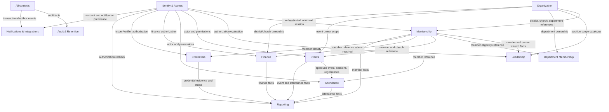

# DYMS Phase 3 — Bounded Context Map

- Revision: BC-01
- Date: 2026-11-02
- Scope: DYMS v1.0, Sango District
- Status: **DETAILED DOMAIN DESIGN PROPOSAL**
- Authority: DFR-001–DFR-006; DDD-001–DDD-015; owner-approved ODR-REC-01 defaults dated 2026-11-02
- Physical ERD: **NOT APPROVED**
- Implementation: **NOT AUTHORIZED**

## 1. Purpose and constraints

This document defines proposed bounded contexts, ownership boundaries, public interfaces, domain events and dependency rules for the DYMS modular monolith.

It refines the context list in `PHASE-3-SYSTEM-DESIGN-BASELINE.md`. It does not approve new ministry policy, change the conceptual ERD, or authorize database or application implementation.

Non-negotiable constraints:

- v1.0 is limited to Sango District.
- Every member has an individual account linked one-to-one to one member record. Guardian-owned, guardian-managed and shared accounts are prohibited.
- DFR-001–DFR-006 and approved DDD decisions remain authoritative.
- Role accumulation never expands organizational scope. Explicit DENY overrides applicable ALLOW.
- Appointment-derived permissions end when the appointment ends or expires.
- Department membership alone grants no leadership permission.
- Blockchain anchoring and public credential verification remain deferred.
- A context owns its domain rules and mutations. Other contexts do not write its records directly.
- Final aggregate and table boundaries remain subject to final physical ERD reconciliation.

## 2. Context map

The diagram shows logical information flow, not permission to access another context's tables. Every arrow must be implemented through a documented application port, read contract, or event contract.

## 3. Context ownership catalogue

| Context | Owns and decides | Publishes / exposes | Must not own |
|---|---|---|---|
| Identity & Access | User account, credentials, sessions, password reset, roles, permissions, explicit denies, authorization evaluation, authentication idempotency | Authenticated actor, session status, authorization decision, security events | Member category, appointment approval, event ownership, finance approval |
| Organization | District, local church, department catalogue and organizational ownership | Stable organization identifiers, hierarchy and active-scope facts | Member's current membership, appointment grants, department participation |
| Membership | Member profile, category assignment history, church membership and transfer requests | Member identity, category and church-membership facts, transfer outcomes | Login credentials, role grants, church catalogue |
| Leadership | Position catalogue, appointment requests and decisions, appointment-derived grants | Effective appointment facts and grant/revocation events | Account authentication, independent role catalogue, organization hierarchy |
| Department Membership | Member requests, coordinator decisions, department participation history | Active department-membership facts and decision events | Department ownership, leadership appointments, account permissions |
| Events | Event lifecycle, owner scope, approvals, changes, sessions, registration | Approved event/session and registration facts | Attendance records, finance posting, notification delivery |
| Attendance | Event attendance subject, event/session records, corrections and attendance summaries | Attendance facts and correction outcomes | Event approval, registration policy, member identity |
| Finance | Financial account, budget, transaction, approval, payment reconciliation, posting and reversal | Financial state changes and reportable financial facts | Identity credentials, event lifecycle, notification provider state |
| Credentials | Credential definitions/versions, evidence references, verification, issuance and revocation | Credential status and issuance facts | Member category policy, account login, public blockchain proof in v1 |
| Reporting | Report definitions, authorized report runs, export lifecycle and export audit request | Report artifacts and run metadata | Source-of-truth business mutations or independent authorization policy |
| Audit & Retention | Append-only audit evidence, audited audit access, approved retention policies, holds and disposal evidence | Audit append port, retention decision outcomes | Business approval decisions or unilateral deletion authority |
| Notifications & Integrations | Notification requests, preferences, templates, outbox dispatch, provider adapters, webhook processing and delivery attempts | Delivery status, integration outcome and operational events | Business transaction truth or authorization decisions |

## 4. Aggregate candidates and consistency boundaries

The following are aggregate-root candidates for detailed ERD reconciliation. They are not final aggregate approval.

| Context | Candidate aggregate root | Consistency boundary |
|---|---|---|
| Identity & Access | UserAccount; AuthSession; IdempotencyRecord | Account credential/security lifecycle; session rotation/revocation; one authentication idempotency claim |
| Organization | District; Church; Department | Organizational identity, ownership and hierarchy |
| Membership | Member; ChurchTransferRequest; MemberCategoryAssignment | Member profile and category history; transfer request and decision history |
| Leadership | Position; Appointment | Position scope and appointment lifecycle, including approval and effective period |
| Department Membership | DepartmentMembership | One member's request, approval, withdrawal and termination history |
| Events | Event; EventRegistration | Event lifecycle/session ownership; one member's registration decision |
| Attendance | EventAttendanceSubject; AttendanceRecord | Selected EVENT or SESSION mode and one attendance fact/correction chain |
| Finance | FinancialAccount; Budget; FinancialTransaction | Account ledger boundaries; budget approval; transaction approval/payment/posting/reversal |
| Credentials | CredentialDefinition; CredentialIssuance | Versioned credential standard; one member issuance and its evidence/revocation history |
| Reporting | ReportDefinition; ReportRun | Versioned report contract; one authorized execution and export lifecycle |
| Audit & Retention | AuditEvent; RetentionPolicy; RetentionHold | Append-only evidence; approved policy version; subject-specific hold |
| Notifications & Integrations | Notification; OutboxMessage; WebhookEvent | Logical notification; durable dispatch message; one provider event |

Aggregate boundaries must be validated against transactional requirements, FK design, concurrency rules and the final physical ERD. Do not infer one table per aggregate.

## 5. Dependency rules

1. Identity & Access is the only context that validates credentials and current sessions.
2. Organization is the authoritative source for district, church and department identity and ownership.
3. Membership owns the member's current church membership. Organization must not duplicate it as a second source of truth.
4. Leadership owns appointments. Identity & Access consumes effective appointment facts to resolve appointment-derived grants; it does not edit appointment records.
5. Department Membership consumes member and department facts. It does not create a role grant.
6. Events owns event/session/registration lifecycle. Attendance consumes the approved event/session and registration facts through a contract.
7. Attendance owns attendance facts. Events must not update attendance rows directly.
8. Finance owns all financial state transitions. Events and other contexts may request a finance workflow through an application port, never post or reverse a transaction directly.
9. Credentials consumes member identity and issuer authorization. It does not change member category.
10. Reporting is read-oriented. It does not mutate source business aggregates.
11. Audit & Retention receives append requests and applies separately approved retention policy. Business contexts cannot delete audit evidence.
12. Notifications & Integrations dispatches committed outbox work. Provider acceptance or delivery never changes business truth.
13. No context imports another context's infrastructure repository or ORM model.
14. Shared kernel is limited to stable primitives: identifiers, time abstractions, money representation, result/error primitives, correlation metadata and audited actor references. Do not place ministry policy in shared code.

## 6. Integration contracts and domain events

Events below are proposed internal integration contracts. Names and payload fields require contract review. Events must carry identifiers and version metadata, not copies of sensitive member or financial records.

| Producer | Proposed event | Consumer purpose |
|---|---|---|
| Identity & Access | AccountActivated, SessionRevoked, SecurityRiskDetected | Notify dependent workflows; enforce session state |
| Organization | ChurchCreated, ChurchOwnershipChanged, DepartmentChanged | Refresh reference data and scope projections |
| Membership | MemberCreated, MemberChurchChanged, MemberCategoryChanged | Update permitted read projections and dependent workflows |
| Leadership | AppointmentApproved, AppointmentEffective, AppointmentEnded | Reconcile appointment-derived grants |
| Department Membership | DepartmentMembershipApproved, DepartmentMembershipEnded | Reporting and authorized eligibility views |
| Events | EventApproved, EventPublished, EventChanged, EventCancelled, RegistrationConfirmed | Attendance setup, notification and reporting |
| Attendance | AttendanceRecorded, AttendanceCorrected | Reporting and credential evidence where explicitly approved |
| Finance | TransactionApproved, PaymentConfirmed, TransactionPosted, TransactionReversed | Reporting and notification |
| Credentials | CredentialIssued, CredentialRevoked | Member views and authorized reports |
| Reporting | ReportRunCompleted, ReportExportExpired | Notify requester and audit lifecycle |
| Notifications & Integrations | NotificationDelivered, NotificationFailed, WebhookRejected | Operational monitoring and delivery status |

### Event envelope

Every internal event should include:

- `event_id`: globally unique event identifier.
- `event_type`: stable, versioned name.
- `schema_version`: integer contract version.
- `occurred_at`: UTC timestamp.
- `producer_context`: owning context.
- `aggregate_type` and `aggregate_id`.
- `correlation_id` and optional `causation_id`.
- `actor_reference`: USER, SYSTEM or SERVICE reference without credentials.
- `payload`: minimum necessary identifiers and approved facts.

Events are published from a durable outbox after the owning transaction commits. Consumers must be idempotent. Redis/BullMQ is a delivery mechanism, not the durable source of event truth.

## 7. Cross-context consistency

Use synchronous application ports when the caller requires an immediate authoritative decision, including:
- session and permission evaluation;
- event-owner authorization;
- finance approval and posting;
- appointment approval;
- credential issuance authorization;
- report scope authorization.

Use asynchronous events for notifications, projections and non-blocking downstream work.

A workflow spanning contexts must identify:
- the context that owns the business decision;
- the transaction boundary;
- the event emitted after commit;
- duplicate-delivery behavior;
- failure and retry handling;
- compensation or manual recovery where a later context fails.

Do not create distributed transactions. Where a business workflow requires coordinated actions, define a durable process manager/saga only after the business owner approves the workflow and failure outcomes.

## 8. Authorization boundary

Authorization is evaluated by Identity & Access for the authenticated actor and requested action/resource. The owning context must still enforce its domain invariants and validate that the requested state transition is legal.

The authorization contract must include:
- authenticated account and active server-side session;
- member link where the operation is member-scoped;
- active role grants and appointment-derived grants;
- explicit organizational scope;
- explicit DENY precedence;
- resource ownership;
- separation-of-duties checks;
- fail-closed behavior for ambiguous scope.

A UI permission check is never authoritative.

## 9. Decisions requiring final reconciliation

| Item | Current treatment | Gate |
|---|---|---|
| Aggregate/table mapping | Candidate map only | Final physical ERD |
| Department and event ownership | ODR-004 owner-approved default; delegated district governance confirmation pending | Authority confirmation |
| Finance state transitions and approval thresholds | Conservative ODR-005 defaults; some options disabled | Finance authority confirmation |
| Attendance mode and exceptional registration | ODR-006 owner-approved proposal | Attendance authority confirmation |
| Report catalogue/classification/disclosure | REPORT-001–010 in 107-ID baseline | Delegated data/security authority |
| Audit Officer and break-glass | Separation accepted as default; exceptional access disabled | Governance/security authority |
| Retention schedules and disposal | Automated permanent deletion disabled | Records/finance/ministry authorities |
| Credential issuer and evidence policy | Not inferred | Official credential authority |
| Event change, waitlist and capacity exceptions | ODR-008 conservative defaults | Event authority |
| Notification channels | In-app baseline; email conditions; SMS/WhatsApp disabled | Consent/provider authority |

## 10. Acceptance checklist

- [ ] Each context has one authoritative owner for its business records.
- [ ] No cross-context direct writes or infrastructure imports.
- [ ] Every synchronous dependency has an application port and authorization contract.
- [ ] Every asynchronous dependency has a versioned event contract and idempotent consumer.
- [ ] Transaction boundaries and failure handling are explicit.
- [ ] The one-account-per-member rule is preserved without guardian entities.
- [ ] All 107 testable requirements map to an owning context.
- [ ] All open ODR authority dependencies remain visible.
- [ ] Aggregate candidates reconcile with the final physical ERD.

## 11. Approval boundary

This is a detailed design proposal. It does not approve the final physical ERD, Prisma schema, SQL DDL, migrations, database objects, API implementation, or application code. Implementation remains **NOT AUTHORIZED**.
