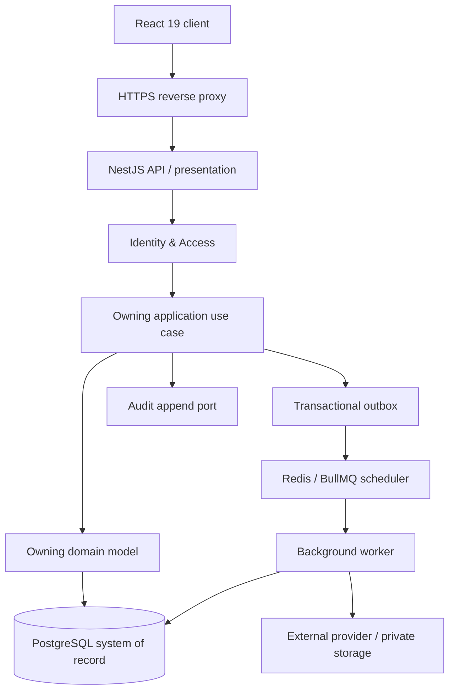
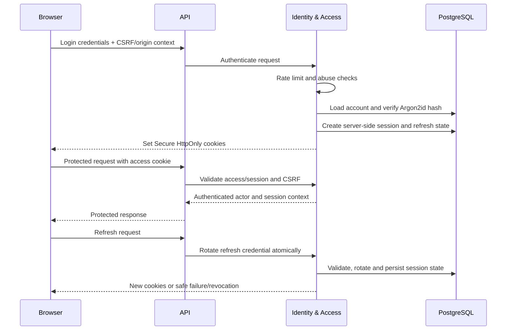
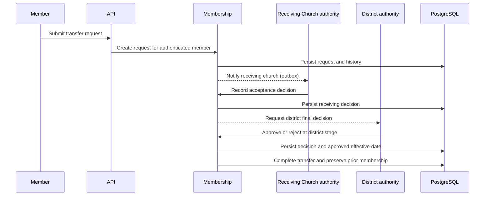
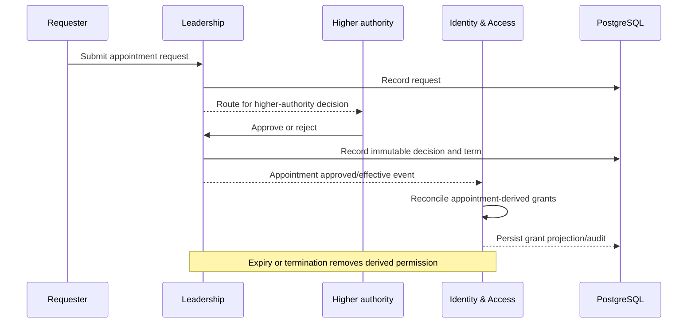
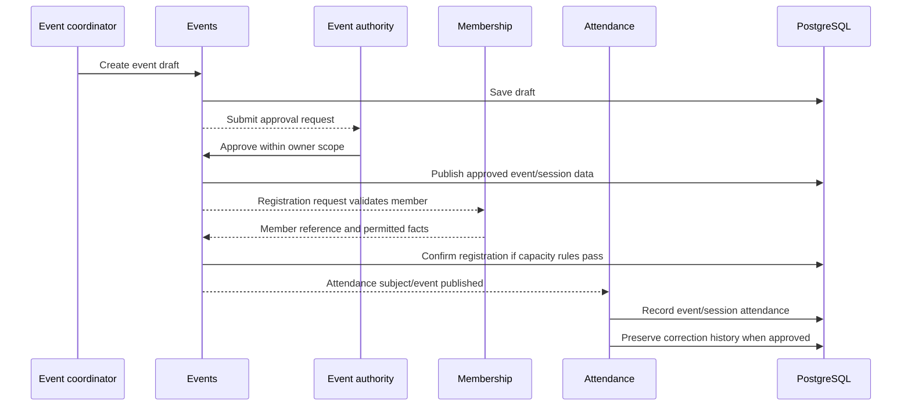
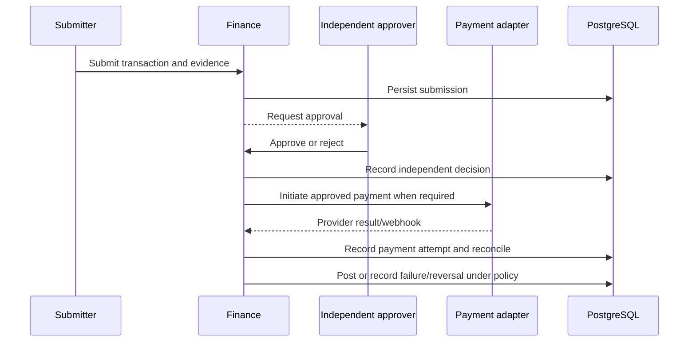
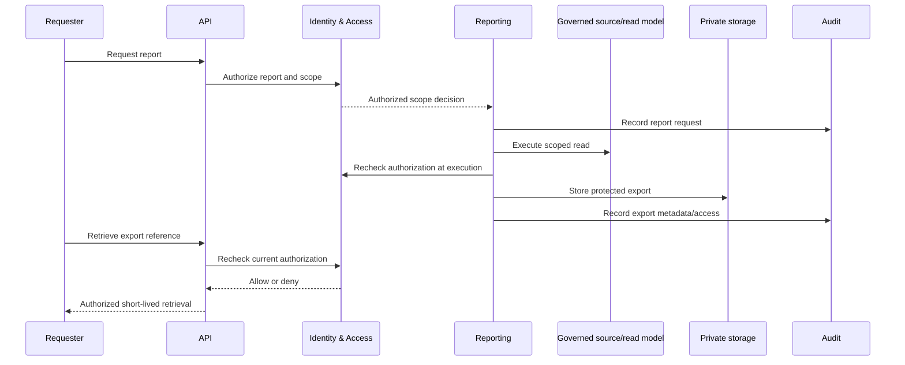

# DYMS Phase 3 — Module Interaction and Dependency Design

- Revision: MID-01
- Date: 2026-11-02
- Scope: DYMS v1.0, Sango District
- Status: **DETAILED INTERACTION DESIGN PROPOSAL**
- Implementation: **NOT AUTHORIZED**

## 1. Purpose

This document converts the bounded-context map into explicit request, transaction, event and worker interaction patterns. It is a design contract for later API and physical ERD reconciliation.

The system remains a modular monolith. Each module owns its domain and application layer. Modules communicate through public application interfaces or versioned internal events. They must not access another module's ORM repositories or mutate its tables directly.

## 2. Runtime interaction model

The application transaction owns business changes, required audit evidence and outbox insertion. External calls do not occur while holding a database transaction open unless a separately reviewed integration contract explicitly requires it.

## 3. Module dependency matrix

| Calling context | Target context | Interaction | Consistency | Restriction |
|---|---|---|---|---|
| All protected modules | Identity & Access | Authenticate session and evaluate permission/scope | Synchronous | No module implements its own session validation |
| Membership | Organization | Resolve district/church references and scope | Synchronous read contract | Membership owns current member-church assignment |
| Leadership | Organization | Resolve position scope and organizational references | Synchronous read contract | Leadership owns appointment lifecycle |
| Identity & Access | Leadership | Consume effective appointment grants/events | Event-driven projection plus authoritative recheck | Identity must not edit appointments |
| Department Membership | Membership / Organization | Resolve member and department references | Synchronous validation | No implicit permission grant |
| Events | Membership / Organization | Resolve member eligibility references and owner scope | Synchronous | Event context owns event lifecycle |
| Attendance | Events / Membership | Validate approved event/session, registration and member references | Synchronous | Attendance owns attendance facts |
| Finance | Organization / Identity & Access | Validate account scope and finance permissions | Synchronous | Finance owns transaction truth |
| Credentials | Membership / Identity & Access | Resolve member and issuer authority | Synchronous | Credential issuance cannot alter membership |
| Reporting | Source contexts | Query approved read contracts or governed read model | Read-only | No source writes; reauthorize at execution |
| Notifications & Integrations | Identity & Access | Resolve eligible account/channel preference | Synchronous or committed projection per contract | No channel dispatch without required consent |
| All contexts | Audit & Retention | Append audit fact | Same transaction/outbox pattern according to criticality | No ordinary update/delete of audit facts |
| All contexts | Notifications & Integrations | Publish durable outbox event | After-commit asynchronous | Provider failure does not roll back business mutation |

## 4. Transaction ownership rules

### 4.1 Single-context command

A command that changes one aggregate is handled by its owning context:
1. Authenticate actor and validate session.
2. Evaluate permission, scope, ownership and separation of duties.
3. Load the aggregate through its repository.
4. Validate domain invariants and expected version/state.
5. Persist aggregate changes and append required history.
6. Append required audit evidence and outbox records within the agreed transaction.
7. Commit and return a stable result.

### 4.2 Cross-context command

A caller must not update another context's data. It must:
1. Validate the caller's own command and authorization.
2. Call the target context's public application port.
3. Let the target context validate its own invariants and authorization requirements.
4. Commit target-owned state and emit a versioned event.
5. Let consumers react asynchronously and idempotently.

If the use case requires both contexts to commit atomically, the design must be reviewed. Do not simulate atomicity with direct table writes.

## 5. Key interaction sequences

### 5.1 Authentication and session refresh

DFR-001 and DFR-004 govern exact authentication behavior. Access credentials expire after 15 minutes; inactivity timeout is 7 days; absolute session lifetime is 30 days; password reset tokens expire after 30 minutes. Refresh reuse detection, CSRF and origin validation, cookie paths and revocation behavior must match the frozen decision register.

### 5.2 Church transfer

The approved core is member initiation, receiving-church acceptance, district final approval and approved-date effective rule. Rejection, withdrawal, cancellation, appeal, pending-request cardinality and detailed backdating rules remain policy blocked. The sequence must not imply those transitions are approved.

### 5.3 Appointment approval and permission lifecycle

No self-approval. Renewal requires fresh approval. The normal annual term is January 1 to December 31. Acting appointments and exceptional overlap remain disabled unless the competent authority approves them.

### 5.4 Event creation, registration and attendance

ODR-006 owner-approved default: each event-member attendance subject selects EVENT or SESSION mode; modes cannot be mixed after the first attendance record; EVENT stores one member/event result; SESSION stores one member/session result and derives event summary. Registration is required except a documented authorized exception. Self-check-in and offline capture remain disabled pending authority confirmation.

ODR-008 owner-approved default: only confirmed registrations consume capacity; waitlists are disabled; late registration reopening and capacity overrides require event-authority approval. The API and database design must not assume unapproved exceptions.

### 5.5 Finance transaction

The submitter cannot approve their own transaction. Payment execution, provider confirmation and ledger posting are distinct states. The owner-approved conservative defaults disable partial payments, multiple successful payments per transaction, FX, refunds and budget exceptions pending finance authority confirmation. Do not infer provider-specific behavior.

### 5.6 Report execution and export

REPORT-001–010 are in the 107-ID testable baseline. The report catalogue, classification, disclosure matrix and export permissions remain subject to delegated data/security authority confirmation. Authorization is rechecked at request, execution and retrieval.

## 6. Outbox and worker contract

The outbox is written in the same transaction as the business mutation it represents. A worker:
1. Claims a pending message with a bounded lease.
2. Verifies the message contract and handler version.
3. Performs an idempotent side effect or provider call.
4. Records the attempt and outcome.
5. Marks the message complete or schedules a bounded retry.
6. Sends exhausted work to controlled review/dead-letter handling and raises an operational alert.

Redis/BullMQ may schedule work, but PostgreSQL outbox rows remain durable. Queue loss must be recoverable by scanning the outbox. A duplicate delivery must not duplicate a financial posting, attendance record, credential issuance or notification side effect.

## 7. Idempotency boundary

Authentication idempotency follows DDD-013 AUTH-IDEM-001–041 and the D13-PDR-01 revision. It is not a general business idempotency policy.

- Authentication idempotency distinguishes AUTHENTICATED and PRE_AUTHENTICATION identity modes.
- The server calculates scope and request fingerprints.
- A matching key with a different request fingerprint returns the approved conflict outcome.
- Fencing counters are monotonic and fail closed on BIGINT overflow.
- Password-reset secrets are held only in the approved protected short-lived secret-store boundary; outbox payloads contain opaque references.
- Business idempotency for finance, attendance, event registration and credential issuance requires separate approved contracts.

## 8. Concurrency and locking principles

Candidate rules for physical review:
- Lock the aggregate or parent row that protects the invariant.
- Define a global lock ordering for workflows that touch more than one aggregate.
- Use unique constraints as final duplicate protection, not only preflight queries.
- Appointment overlap uses the approved candidate parent-position lock and half-open intervals, pending final physical review.
- Event capacity checks must serialize against the event/registration capacity owner.
- Attendance uniqueness must match the selected EVENT or SESSION subject mode.
- Finance posting and reversal must be atomic and protected from duplicate provider callbacks.
- Refresh rotation and idempotency claims must be atomic.
- Never use Redis locks as the sole protection for a PostgreSQL invariant.

Exact SQL locking, indexes, isolation level and retry behavior belong in the physical design and implementation review.

## 9. Failure handling and compensation

| Failure | Required behavior |
|---|---|
| Authorization service unavailable | Fail closed for protected operation |
| Target context rejects command | Return stable domain error; do not partially mutate caller-owned state |
| Outbox dispatch delayed | Keep durable message; retry without repeating business mutation |
| Provider timeout/unknown outcome | Reconcile provider event/reference before retrying side effect |
| Duplicate webhook | Deduplicate by provider event identity and idempotent handler |
| Stale worker | Reject completion using lease/fencing contract |
| Queue unavailable | Preserve outbox; resume dispatch after recovery |
| Report authorization revoked | Deny execution or retrieval on recheck |
| Finance provider failure | Record failed attempt; do not mark payment successful or roll back unrelated committed business action |
| Irrecoverable cross-context inconsistency | Create audited operational case and require authorized/manual recovery |

Do not invent automatic compensation for ministry, finance or membership decisions. Each compensating action must be a new authorized business action with history.

## 10. Dependency enforcement

- Domain layer imports no NestJS, Prisma, Redis, BullMQ, HTTP or provider SDK.
- Application layer depends on domain and declared ports.
- Infrastructure implements ports.
- Presentation depends on application use cases and DTOs.
- Cross-module imports target public application contracts only.
- Shared kernel remains small and policy-neutral.
- Architecture tests must reject circular module dependencies and cross-context infrastructure imports.

## 11. Approval boundary

This document is a design proposal. It does not authorize application code, Prisma schema, migrations, SQL DDL, database objects, seeds, deployment resources or API implementation. Final physical ERD approval and separate implementation authorization remain outstanding.
