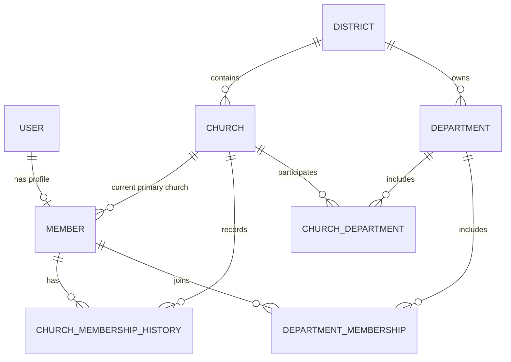
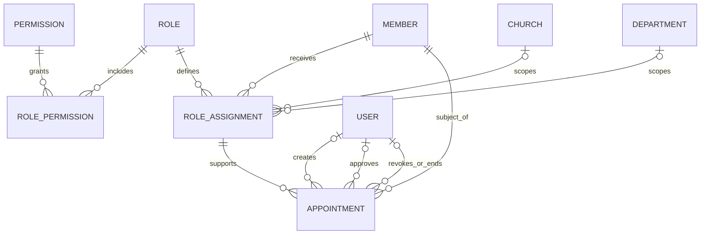
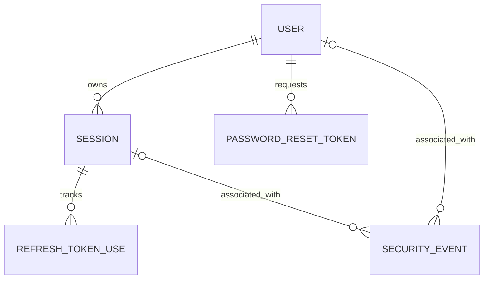
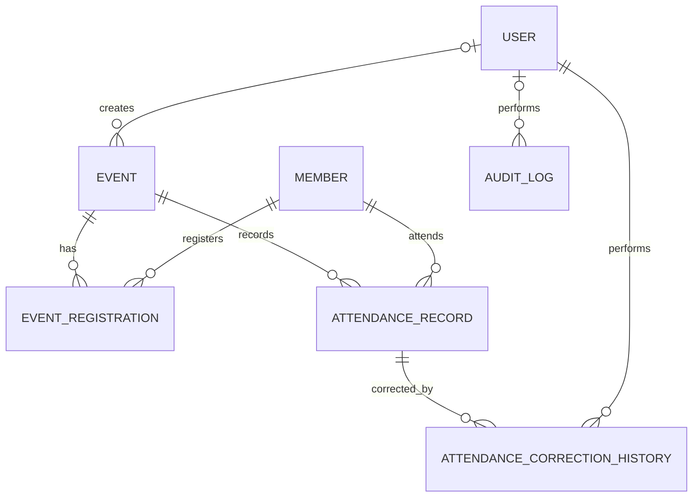
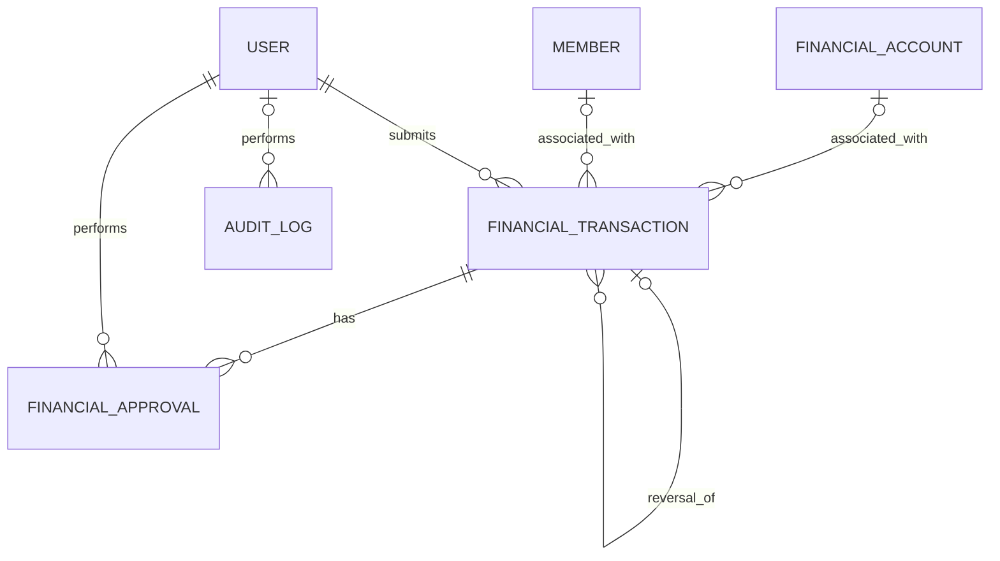
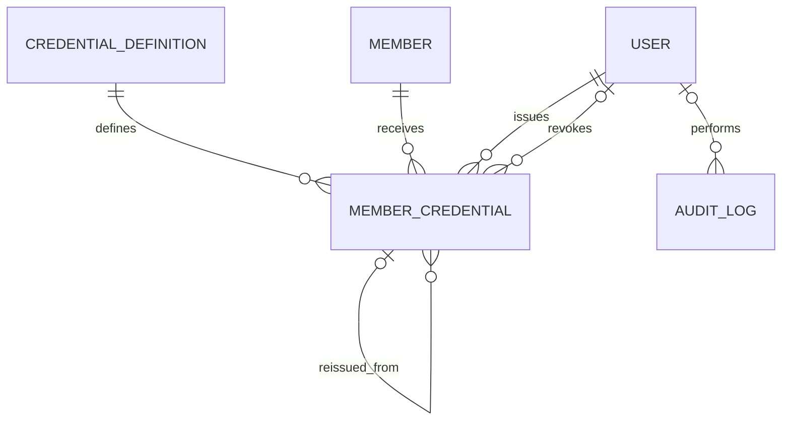
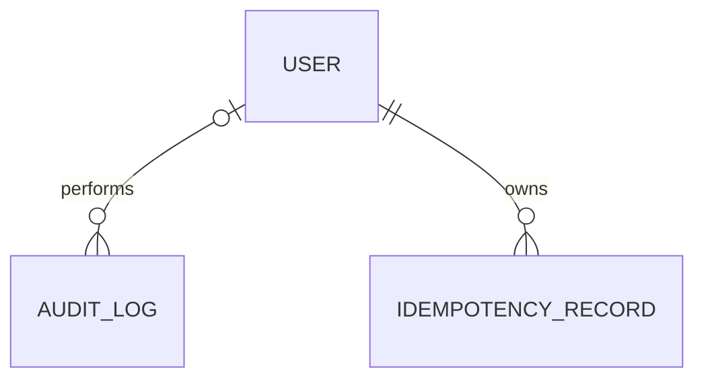

# DYMS Entity Relationship Diagram (ERD)

> **Restoration and current-decision note (2026-10-30):** This document is restored from the latest recoverable project snapshot located in the user's saved files. Its original content is retained as the design baseline, with the status corrections below taking precedence wherever older text conflicts. This restoration is not ERD approval and does not authorize Prisma models or migrations.
>
> - DFR-006 is historical and was lifted on 2026-10-29. Implementation was authorized, but database schema work remains gated on explicit approval of the corrected ERD.
> - User–Member cardinality is approved as one-to-one (MEM-02).
> - A 21-year-old may hold both Ambassador and Young Adult affiliations, subject to local ministry approval. Do not force exclusivity at age 21.
> - Each Member has one current primary church; transfers close the previous membership and open the new one atomically while preserving history (DDD-003).
> - Leadership terms are January 1–December 31; renewals create new historical appointments, require higher-authority action, and prohibit self-renewal (DDD-004).
> - DDD-013 authentication idempotency is specified in the consolidated specification and remains subject to the consistency-review gaps and ERD-slice validation.

## 1. Document Status

- **Status:** Proposed design draft
- **Product:** District Youth Management System (DYMS)
- **Target release:** v1.0
- **Organizational scope:** Sango District
- **Database:** PostgreSQL
- **ORM:** Prisma
- **Design freeze:** DFR-006 was historically approved and was lifted on 2026-10-29; implementation was authorized, subject to the remaining ERD and schema approval gates
- **Review state:** Remediated proposed design; awaiting explicit user approval

This document proposes entity relationships and cardinalities for review. It does not claim that the design has been approved, implemented, or tested.

No Prisma models or migrations are authorized by this draft alone.

The canonical entity inventory is reconciled with
[`DATA-MODEL.md`](DATA-MODEL.md). The evidence, unresolved-decision
classification, and implementation-deliverable traceability are recorded in
[`REQUIREMENTS-TRACEABILITY.md`](REQUIREMENTS-TRACEABILITY.md); the proposed
enforcement and test obligations are recorded in
[`INVARIANT-ENFORCEMENT-REGISTER.md`](INVARIANT-ENFORCEMENT-REGISTER.md).
Neither companion document approves a proposed product rule.

The current remediation outcome and user approval checklist are in
[`ERD-FINAL-REVIEW.md`](ERD-FINAL-REVIEW.md).

## 2. Modeling Conventions

- Internal primary keys use UUIDs.
- Foreign keys and uniqueness constraints protect relational integrity.
- Many-to-many relationships use explicit junction entities.
- Historical records are preserved where required.
- Critical state changes use database transactions.
- Authorization is enforced server-side.
- Money uses fixed-precision decimal values.
- Timestamps use UTC semantics; event time zones are retained.
- Raw authentication tokens and secrets must never be stored or logged.
- Rate limiting remains mandatory.
- Relationships in this document are conceptual and require review before implementation.

### 2.1 Reconciled entity inventory and notation

The following is the complete conceptual inventory shared by this ERD and the
database domain model. Entity names in uppercase identify conceptual database
entities; implementation naming remains a later schema decision.

| Domain                | Entities                                                                            |
| --------------------- | ----------------------------------------------------------------------------------- |
| Identity              | `USER`, `MEMBER`                                                                    |
| Organization          | `DISTRICT`, `CHURCH`, `DEPARTMENT`, `CHURCH_DEPARTMENT`                             |
| Membership            | `CHURCH_MEMBERSHIP_HISTORY`, `DEPARTMENT_MEMBERSHIP`                                |
| Authorization         | `ROLE`, `PERMISSION`, `ROLE_PERMISSION`, `ROLE_ASSIGNMENT`, `APPOINTMENT`           |
| Authentication        | `SESSION`, `REFRESH_TOKEN_USE`, `PASSWORD_RESET_TOKEN`, `SECURITY_EVENT`            |
| Events and attendance | `EVENT`, `EVENT_REGISTRATION`, `ATTENDANCE_RECORD`, `ATTENDANCE_CORRECTION_HISTORY` |
| Finance               | `FINANCIAL_ACCOUNT`, `FINANCIAL_TRANSACTION`, `FINANCIAL_APPROVAL`                  |
| Credentials           | `CREDENTIAL_DEFINITION`, `MEMBER_CREDENTIAL`                                        |
| Audit and idempotency | `AUDIT_LOG`, `IDEMPOTENCY_RECORD`                                                   |

`ROLE_PERMISSION` and `REFRESH_TOKEN_USE` are part of the inventory. Their
absence from an earlier data-model inventory was a documentation omission,
not approval to omit either relationship from a later schema.

Each domain section below states the conceptual relationships and lifecycle
requirements. [`DATA-MODEL.md`](DATA-MODEL.md) is the companion entity
catalogue: for every entity it identifies the owning domain, purpose, key
relationships, historical treatment, and unresolved field or product-rule
decisions. The two documents must be changed together if the inventory
changes.

## 3. Organization and Membership

### 3.1 Identity and Member association

- Every Member must be associated with exactly one User account.
- A User may be associated with at most one Member.
- A unique foreign key can enforce the at-most-one relationship, but mandatory Member-to-User participation requires an appropriate database-level mechanism or a reliable application creation workflow.
- Account provisioning and failure handling must ensure that a Member is never left without its required User association.
- Passwords must be hashed with Argon2id; raw passwords must never be stored.

### 3.2 Primary church and transfers

- Every Member has exactly one current primary church.
- `CHURCH ||--o{ MEMBER` represents the relationship to the current primary church; it does not, by itself, enforce every cross-row lifecycle invariant.
- `CHURCH_MEMBERSHIP_HISTORY` preserves previous church memberships and their effective dates.
- A transfer must update the Member's current church reference and close the previous history record while opening the new one in a single database transaction.
- The implementation must prevent concurrent transfers from creating multiple current primary-church assignments.
- Appropriate database constraints and transaction-level concurrency controls must enforce the invariant.

### 3.3 Department participation

- `CHURCH_DEPARTMENT` records whether a church participates in a district department.
- `DEPARTMENT_MEMBERSHIP` records an individual Member's participation.
- These relationships have separate lifecycles.
- A Member may participate in multiple district departments simultaneously, including departments in which their primary church does not participate.
- Department membership must retain status, effective dates, and relevant history.
- Department participation does not change primary church membership and does not automatically grant leadership permissions.

### 3.4 Member categories and credentials

- The v1.0 member categories are `ADVENTURER`, `PATHFINDER`, and `SENIOR_YOUTH`.
- Master Guide is a credential, not a member category.
- Every Master Guide is a Senior Youth, but not every Senior Youth is a Master Guide.
- Category transitions and their historical treatment must be resolved against the approved requirements before schema implementation.

### 3.5 Implementation review requirements

Before approving the schema, verify:

- The mandatory Member-to-User association and account-provisioning workflow.
- The current primary-church invariant and concurrent-transfer protection.
- Effective dates and history for church transfers.
- Unique church participation per department where applicable.
- Department membership status, effective dates, and history.
- Appropriate foreign keys, uniqueness constraints, indexes, deletion restrictions, and transaction boundaries.

## 4. Leadership and Authorization

### 4.1 Design decision

DYMS uses separate but linked `ROLE_ASSIGNMENT` and `APPOINTMENT` records.

- `ROLE_ASSIGNMENT` records the role granted to a Member within an explicitly defined organizational scope.
- `APPOINTMENT` records a time-bounded leadership designation, its effective term, approval authority, and lifecycle.
- An appointment must link to the role assignment through which its leadership authority is represented.
- A role assignment that requires an appointment must not confer effective leadership permissions without a valid appointment.
- Role assignments that do not require appointments may exist independently, subject to their own authorization rules.
- Neither record grants permissions outside its approved scope.

### 4.2 Entity relationships

The authorization model must represent roles, permissions, role assignments, and appointments as distinct concepts.

- `ROLE` defines a named role.
- `PERMISSION` defines a specific action the system can authorize.
- `ROLE_PERMISSION` associates roles with the permissions granted to them.
- `ROLE_ASSIGNMENT` grants a role to a Member within an explicitly defined organizational scope.
- `APPOINTMENT` records a time-bounded leadership designation linked to the relevant role assignment.

`ROLE_PERMISSION` is a proposed explicit junction entity for the many-to-many relationship between roles and permissions. Its exact fields, uniqueness constraints, and lifecycle must be verified against the authoritative requirements before schema implementation.

The diagram describes conceptual relationships. It does not, by itself, enforce permission scope, appointment validity, authorization precedence, or cross-record consistency.

### 4.2.1 Appointment subjects and actors

An appointment has four distinct identities. They must not be conflated in a
future schema or audit view:

- **Subject Member:** the Member receiving the appointment. This association
  is required.
- **Role assignment:** the required `ROLE_ASSIGNMENT` whose authority the
  appointment activates or governs. The records must agree on Member, role,
  and organizational scope.
- **Creator:** the authenticated User or formally represented system actor
  that initiated the appointment record. Creation is not approval and does
  not establish authority.
- **Approver:** the authorized higher authority that approves or renews the
  appointment. It is required when the appointment reaches an approved or
  active state; the approving authority must be retained.
- **Revoking or ending actor:** the User or system actor recorded when an
  appointment is ended before natural expiry, where that lifecycle action is
  supported. Natural expiry is derived from the effective end date and need
  not imply a human revoking actor.

The direct actor references shown in the diagram are conceptual. A future
schema may use explicit nullable actor foreign keys, an immutable lifecycle
record, or both, provided the approved actor, action, time, scope, and audit
requirements remain queryable. The representation of a system actor remains
an unresolved design decision; an absent human actor must never look like an
unattributed security-sensitive action.

### 4.2.2 Effective authority and conflicting appointments

Effective authority is derived server-side from the authenticated User, its
Member, account and membership state, a role's permissions, the assignment's
scope, and a valid required appointment. An active appointment does not add
permissions outside the linked assignment; an expired, ended, revoked, or
suspended appointment contributes no appointment-dependent authority. Its
historical record remains available. Account or membership suspension also
removes effective access under the approved authorization rules without
deleting history.

The available sources do not define a role catalogue, permission-precedence
algorithm, conflicting-position matrix, or whether a role assignment may be
appointment-independent for each role. The final authorization policy must
therefore specify how permissions combine when multiple assignments or
appointments exist, how a deny or conflict is resolved, and which scopes or
terms may overlap. Until then, implementation must not infer a precedence
algorithm or impose a universal one-active-appointment uniqueness rule.

At minimum, the schema review must specify a stable scope identity and an
effective-period conflict check for duplicate or contradictory active
assignment and appointment records. Exact composite unique keys and overlap
rules are blocked on the unresolved policy above. Creation, approval, renewal,
ending, and audit recording are a single transaction-safe lifecycle workflow;
the acting User must be checked against the subject Member to prevent
self-appointment, self-renewal, and prohibited self-approval.

### 4.2.3 Permission and role-assignment rules

- A role may be associated with multiple permissions, and a permission may be associated with multiple roles.
- A role assignment must identify the role and organizational scope to which it applies.
- Effective access must be derived from trusted server-side records and the approved authorization rules.
- A permission associated with a role must not grant access beyond the role assignment's approved organizational scope.
- Where a permission requires an appointment, the appointment must be valid and linked to the applicable role assignment.
- Appointment-independent role assignments may exist only under their applicable authorization rules.
- Technical administrator privileges must not automatically grant financial approval or credential-issuance authority.
- The implementation must define how permission changes affect existing role assignments and how such changes are audited.

The precise permission catalogue, scope rules, and treatment of permission changes remain subject to verification against the authoritative product requirements.

### 4.3 Role assignment and appointment lifecycle

- A role assignment must identify the role and organizational scope to which it applies.
- An appointment must identify the Member being appointed and the role assignment associated with that appointment.
- The role assignment and appointment must agree on the Member, role, and applicable organizational scope.
- Appointment approval and the creation or activation of its associated role assignment must follow a defined, transaction-safe workflow.
- The implementation must prevent an appointment from activating a role assignment outside the appointment's approved scope.
- The implementation must define how role assignments are ended, superseded, or retained when an appointment expires, is terminated, or is renewed.
- Historical appointments and role assignments must remain available for authorized audit and reporting.
- Historical records must not grant current permissions solely because their records remain in the database.

### 4.4 Appointment terms and renewal

- The approved annual appointment period runs from January 1 through December 31.
- The final lifecycle rules must define the treatment of appointments created, ended, or renewed during a calendar year.
- Appointments must retain explicit effective dates and lifecycle states.
- Renewal must preserve the previous appointment period as historical information.
- Renewal must be performed by the authorized higher authority.
- A Member must not appoint themselves or renew their own appointment.
- The system must record the approving authority and relevant lifecycle information.
- An expired or ended appointment must no longer confer appointment-derived permissions.
- Ending an appointment must not automatically deactivate the associated User account or delete the Member.

### 4.5 Authorization requirements

The server must derive effective access from trusted records. A client-supplied identifier must never, by itself, grant access to another organization's records.

Authorization decisions must consider, as applicable:

- The authenticated User and associated Member.
- Active membership and account-status requirements.
- The role and permissions granted by a valid role assignment.
- The existence and validity of any required appointment.
- Appointment effective dates and lifecycle state.
- Organizational scope, resource ownership, and applicable business rules.
- Separation-of-duties restrictions and the authority of the acting User.

Appointment-dependent permissions must cease to be effective when the appointment expires or ends, even if historical role-assignment and appointment records remain stored.

Technical administrator privileges do not automatically grant financial approval or credential-issuance authority.

### 4.6 Separation of duties and auditability

- Self-appointment, prohibited self-renewal, and prohibited self-approval must be prevented by application rules and covered by automated tests.
- The system must verify that the approving authority is authorized to approve or renew the appointment within the relevant organizational scope.
- Appointment creation, approval, renewal, termination, and other material lifecycle changes must be auditable.
- Authorization checks must be enforced on the server for every protected operation; hiding a user-interface control is not an authorization mechanism.

### 4.7 Implementation review requirements

Before Prisma schema implementation, verify:

- The required relationship between `APPOINTMENT` and `ROLE_ASSIGNMENT`.
- Consistency of the Member, role, and organizational scope across linked records.
- The distinction between appointment-dependent and independent role assignments.
- The annual appointment lifecycle, including mid-year creation, termination, and renewal.
- The authorized higher authority for appointment approval and renewal.
- Prevention of self-appointment, self-renewal, and self-approval.
- Expiration and termination behavior for appointment-derived permissions.
- Historical record preservation and auditability.
- Appropriate foreign keys, uniqueness constraints, indexes, deletion restrictions, transaction boundaries, and authorization tests.

## 5. Authentication and Security Records

### 5.1 Design decisions

The authentication domain uses persistent server-side sessions, rotating refresh credentials, single-use password-reset tokens, and security-event records.

The proposed entities are:

- `SESSION`
- `REFRESH_TOKEN_USE`
- `PASSWORD_RESET_TOKEN`
- `SECURITY_EVENT`

Passwords must be hashed with Argon2id. Raw passwords, refresh credentials, password-reset tokens, and other authentication secrets must never be stored or logged.

Authentication and authorization decisions must be derived from trusted server-side records. Long-lived authentication credentials must not be stored in browser local storage.

### 5.2 Entity relationships

These relationships are conceptual. Database constraints and transaction-safe workflows must enforce token uniqueness, session ownership, lifecycle rules, and the required consistency between records.

A security event may be associated with a User, a Session, both, or neither when the event occurs before an identity or session can be reliably established. Security-event records must not require a valid active session to be recorded.

### 5.3 Session lifecycle

Each authenticated session has one persistent `SESSION` record.

The session must support:

- Association with its owning User.
- Current session status and creation time.
- Last-activity tracking.
- Inactivity expiration.
- Absolute expiration.
- Session revocation and its relevant metadata.
- Refresh-token rotation state.
- Per-session revocation and account-wide session revocation.

Approved authentication parameters from DFR-004:

- Access credential lifetime: 15 minutes.
- Session inactivity timeout: 7 days.
- Absolute session lifetime: 30 days.
- Password-reset token lifetime: 30 minutes.
- Refresh credentials must not extend a session beyond its absolute expiration.

The server must reject expired or revoked sessions and must enforce inactivity and absolute expiration independently.

A successful refresh must not extend the absolute session expiration. Session revocation, password-reset invalidation, and account-suspension invalidation must prevent further use of the affected session.

### 5.4 Refresh-token rotation history

`REFRESH_TOKEN_USE` records the lifecycle of individual refresh credentials associated with a session. It stores token hashes or secure token-hash fingerprints, never raw refresh credentials.

Each refresh-token record must support the information needed to establish:

- Its associated session.
- A unique token identifier or hash suitable for lookup.
- Its lifecycle state.
- Its creation and expiration times.
- Whether and when it was consumed.
- Its relationship to the replacement token, where required for rotation history.

The detailed schema must define the exact fields and constraints before implementation.

#### Rotation requirements

- Refresh credentials must rotate after successful use.
- A refresh token may be consumed successfully only once.
- Rotation must atomically consume the current token and create its replacement.
- Concurrent refresh requests must be serialized or otherwise coordinated to prevent multiple successful rotations from the same token.
- A refresh credential must not extend the session beyond its absolute expiration.
- Token records must remain available for the period required to detect reuse and investigate relevant security events.
- Token-history retention must not exceed the applicable session and approved security-retention requirements without a documented basis.

#### Reuse detection and response

The approved refresh-token lifecycle is:

1. Validate the refresh credential and its associated session.
2. Verify that the session is active and has not exceeded its inactivity or absolute expiration.
3. Confirm that the token is the current, unconsumed refresh credential.
4. Atomically consume the current token, create its replacement, and update the session's current refresh state.
5. Record the relevant security event when required by the event policy.
6. If a previously consumed token is presented again and confirmed as reused, revoke the affected session and record the security event in the same transaction where feasible.
7. Do not treat a hash mismatch alone as conclusive evidence of replay. An unknown or unrelated invalid token must not, by itself, trigger account-wide session revocation.

A confirmed refresh-token reuse must not be silently accepted or result in another successful rotation from the consumed token.

#### Lost refresh response

The frontend must coordinate refresh requests so that only one refresh operation is in progress per session at a time.

If rotation succeeds on the server but the response containing the replacement credential is lost, the client must not assume that the consumed credential remains valid. If the new credential cannot be recovered through an explicitly approved recovery mechanism, the client must reauthenticate.

The system must not introduce a grace period that silently accepts reuse of a consumed refresh credential.

### 5.5 Password-reset tokens

`PASSWORD_RESET_TOKEN` supports secure, time-limited, single-use password-reset workflows.

Requirements:

- Store a secure token hash, never the raw reset token.
- Associate the token with the intended User.
- Record issuance and expiration times.
- Expire the token after 30 minutes.
- Enforce single use.
- Invalidate the token after successful password reset.
- Prevent reuse of consumed or expired tokens.
- Avoid logging reset tokens or other authentication secrets.
- Apply rate limiting and brute-force protection to reset-request and reset-validation endpoints.

A successful password reset must invalidate affected sessions as required by DFR-001 and DFR-004. The reset operation, token consumption, password update, and session invalidation must follow a transaction-safe workflow.

### 5.6 Security events

`SECURITY_EVENT` records relevant security activity, including:

- Authentication failures.
- Successful or unsuccessful refresh operations where required by the event policy.
- Confirmed refresh-token reuse.
- Session revocation.
- Account-wide logout and revocation.
- Password-reset activity.
- Authorization failures.
- Account suspension and related session invalidation.
- Other material security events defined by the security policy.

Security-event records must not contain raw passwords, raw refresh credentials, raw password-reset tokens, or other secrets.

The event model must support timestamps, event classification, and relevant User or Session associations when those associations are known. Additional request or correlation metadata may be retained where appropriate and safe.

Security-event recording must remain available when a request is unauthorized or an account is inactive. Sensitive security events must be recorded consistently with the corresponding state changes, using transaction-safe processing or an explicitly defined reliable recording mechanism.

### 5.7 Authentication and browser security requirements

The implementation must preserve the following approved requirements:

- Argon2id password hashing.
- Short-lived access credentials.
- Rotating refresh credentials with server-side session validation.
- Persistent server-side sessions and revocation.
- Secure, HttpOnly browser cookies.
- CSRF protection for cookie-authenticated state-changing requests.
- Explicit CORS origin allowlist.
- Rate limiting and brute-force protection.
- Refresh-token reuse detection and defined revocation behavior.
- Single-use, expiring password-reset tokens.
- No long-lived authentication tokens in browser local storage.

Approved DFR-004 cookie and deployment parameters:

- Same-origin production deployment through HTTPS.
- Secure, HttpOnly, host-only cookies with `SameSite=Lax`.
- Access cookie path: `/api/v1`.
- Refresh cookie path: `/api/v1/auth`.
- Session-bound synchronizer CSRF token and origin validation.
- Coordinated frontend refresh and atomic backend rotation.
- Per-session revocation and logout from all devices.
- Session invalidation following password reset or account suspension.

The implementation must not weaken these approved requirements without formal change control.

### 5.8 Implementation review requirements

Before Prisma schema implementation, verify:

- Session ownership and the association between User and Session.
- Access credential and session expiration enforcement.
- The 7-day inactivity timeout and 30-day absolute session lifetime.
- Refresh-token hash storage and single-use rotation.
- Token-history uniqueness and lifecycle constraints.
- Atomic rotation under concurrent requests.
- Confirmed reuse detection and affected-session revocation.
- Security-event recording for confirmed reuse and relevant failures.
- Lost-response behavior and reauthentication requirements.
- Password-reset token hashing, 30-minute expiry, single use, and invalidation.
- Session invalidation following password reset or account suspension.
- Account-wide logout and per-session revocation.
- Rate limiting, brute-force protection, CSRF protection, CORS allowlisting, and cookie settings.
- Appropriate foreign keys, uniqueness constraints, indexes, deletion restrictions, transaction boundaries, and security tests.

No Prisma schema, migrations, or authentication implementation may be created until the ERD review is complete and the implementation gate is explicitly approved.

## 6. Events and Attendance

### 6.1 Proposed entities and relationships

The events and attendance domain contains:

- `EVENT`
- `EVENT_REGISTRATION`
- `ATTENDANCE_RECORD`
- `ATTENDANCE_CORRECTION_HISTORY`

Attendance corrections must also produce a related `AUDIT_LOG` entry. The audit relationship represents the logical association between a business operation and its audit record.

These are conceptual relationships. The diagram does not, by itself, enforce registration rules, attendance uniqueness, authorization, concurrency controls, or transaction boundaries.

### 6.2 Event scheduling and registration

- Events must support scheduling and preserve UTC-consistent timestamps together with the relevant event time zone.
- Event registration must be supported where applicable.
- Registration must respect the event's approved registration rules.
- Registration limits, event ownership, and any additional registration lifecycle rules must be verified against the authoritative product requirements before schema implementation.
- No registration limit, ownership rule, or additional event lifecycle requirement may be assumed to have been approved merely because it appears plausible.

### 6.2.1 Event policy decisions still required

The authoritative product requirements must specify the event owner and
organizational scope; registration eligibility and active-registration
uniqueness; cancellation and event lifecycle; capacity and any waitlist rules;
and retention or deletion restrictions. Until then, `EVENT_REGISTRATION` must
not imply that registration is mandatory, capacity-limited, cancellable, or
waitlisted. These are product-policy questions, not omissions a future schema
may answer by assumption.

### 6.3 Attendance records

- Each attendance record must be associated with the relevant event and Member.
- Attendance records must remain within the approved organizational and authorization scope.
- The implementation must define how duplicate scans and repeated attendance submissions are identified and handled.
- Sensitive attendance mutations must use appropriate authorization, audit, transaction, and idempotency controls.
- Attendance history must not be silently overwritten or deleted.

### 6.4 Attendance correction history

An attendance correction must preserve the original `ATTENDANCE_RECORD` and create a separate `ATTENDANCE_CORRECTION_HISTORY` entry.

Each correction-history entry must capture:

- The previous attendance value.
- The corrected attendance value.
- The reason for the correction.
- The actor performing the correction.
- The correction timestamp.
- The request or correlation identifier, where available.

Corrections must be authorized and audited.

The attendance change, correction-history entry, and related `AUDIT_LOG` entry must be handled consistently within a database transaction. The operation must not leave the attendance record changed without its corresponding correction history, or leave a committed correction without its required audit record, unless a formally defined reliable alternative provides equivalent consistency guarantees.

### 6.5 Duplicate scans and concurrent corrections

The implementation design must resolve the following before schema implementation:

- How duplicate attendance scans are identified, including any applicable idempotency key or uniqueness rule.
- Whether repeated scans return the original result or produce a defined conflict response.
- How concurrent scans for the same Member and event are serialized or otherwise prevented from creating inconsistent records.
- How concurrent corrections are detected and prevented from silently overwriting newer values.
- Whether corrections use an expected-current-value check, version field, locking strategy, or another defined concurrency-control mechanism.
- How correction history, audit entries, and any idempotency records remain consistent when an operation fails or is retried.

These decisions must be grounded in the approved product requirements and documented before implementation. The ERD must not imply that duplicate-scan or concurrency behavior is already finalized.

### 6.6 Authorization, history, and integrity

- Every attendance operation must be authorized on the server.
- A client-supplied Member, Event, or organization identifier must not, by itself, grant access.
- Correction actors must be recorded and must have the required authority for the relevant event and organizational scope.
- Historical attendance and correction records must be preserved.
- Audit records must remain append-only under the approved audit policy.
- Foreign keys, uniqueness constraints, indexes, deletion restrictions, and transaction boundaries must be reviewed before implementation.
- Timestamps must follow the approved UTC and event-time-zone conventions.
- The v1.0 implementation must remain within Sango District's approved organizational scope.

### 6.7 Implementation review requirements

Before Prisma schema implementation, verify:

- Event scheduling and event-time-zone representation.
- Registration lifecycle and limits against the authoritative product requirements.
- Event ownership and authorization rules against the authoritative product requirements.
- Attendance-to-Event and attendance-to-Member integrity.
- Duplicate-scan detection and retry behavior.
- Concurrent attendance-update handling.
- Correction-history completeness and preservation.
- Required `AUDIT_LOG` association and transactional consistency.
- Correction authorization, reason capture, actor identity, timestamps, and request identifiers.
- Appropriate idempotency, foreign-key, uniqueness, indexing, deletion, and concurrency controls.
- Consistency with the approved audit, security, and organizational-scope requirements.

No Prisma schema, migration, or application implementation may be created until the ERD review is complete and the implementation gate is explicitly approved.

## 7. Finance

### 7.1 Proposed entities and relationships

The finance domain contains:

- `FINANCIAL_ACCOUNT`
- `FINANCIAL_TRANSACTION`
- `FINANCIAL_APPROVAL`

Financial transactions and their lifecycle changes must be authorized, auditable, and transaction-safe. The conceptual relationship between financial accounts and transactions must be verified against the authoritative product requirements before schema implementation.

These are conceptual relationships. They do not, by themselves, enforce approval eligibility, posting rules, reversal uniqueness, account ownership, or transaction boundaries.

### 7.2 Monetary values and financial records

- Monetary values must use fixed-precision decimal types.
- Currency must have an explicitly defined representation.
- Financial records must preserve their historical meaning.
- Posted transactions must not be deleted or overwritten to change their financial meaning.
- Changes to a posted transaction must follow the approved reversal workflow.
- Financial records and lifecycle transitions must be protected by appropriate authorization and audit controls.

Currency rules, account ownership, transaction numbering, and the complete financial lifecycle remain requirements to verify against the authoritative product requirements.

### 7.2.1 Financial policy boundaries not supplied by the current evidence

The current design establishes controls, not a complete accounting policy.
Before schema implementation, an authoritative source must identify the owner
and organizational scope of each financial account; whether a transaction must
reference an account; permitted currency representation and decimal precision;
transaction numbering and its uniqueness; and the allowed lifecycle from
creation through submission, review, approval, posting, reversal, and viewing.

It must also identify which scoped roles may perform each action, the approval
hierarchy, thresholds, and stages, and the concurrency rules for approval,
posting, and reversal. The approved controls remain unchanged: a submitter
cannot approve their own transaction, posted meaning is immutable, a
correction is a linked reasoned reversal, and duplicate reversal must be
prevented. No approval amount, account category, numbering format, or workflow
stage is inferred by this ERD.

### 7.3 Approval and separation of duties

- A transaction creator or submitter must not approve their own transaction.
- Approval must be performed by an authorized User with the required authority for the relevant organizational scope.
- Technical administrator privileges must not automatically grant financial approval authority.
- The system must enforce separation of duties on the server.
- Approval records must preserve the approving actor and relevant approval information.
- The implementation must define how approval relates to posting and whether multiple approval records are permitted.
- Approval, posting, and their associated audit records must be handled consistently within database transactions.

Approval thresholds, the authorized approval hierarchy, and any multi-stage approval requirements must be verified before schema implementation. They must not be inferred from the current ERD.

### 7.4 Posted transactions and reversals

A correction to a posted transaction must use a new linked reversal transaction. The original posted transaction must remain unchanged.

The reversal workflow must enforce the following requirements:

- A reversal must identify the original transaction it reverses.
- A reversal must contain a mandatory reason.
- The original transaction must remain preserved and available for authorized audit and reporting.
- A posted transaction must not be reversed more than once unless a formally approved financial rule explicitly permits a different model.
- The system must prevent duplicate reversals using appropriate database constraints and transaction-level controls.
- Reversal authorization and the relationship between the original and reversal must be validated on the server.
- Reversal creation, the relevant financial state changes, and associated audit records must be handled consistently within database transactions.
- A failed reversal must not leave a partially applied financial correction.
- A reversal must not silently modify or delete the original transaction.

The detailed rules for reversal status, posting, and any additional approval requirements must be verified before implementation.

### 7.5 Auditability and idempotency

- Sensitive financial operations must be authorized and audited.
- Audit records must capture the relevant actor, action, target, timestamp, organizational scope, and applicable reason or change metadata.
- Audit history must remain append-only under the approved audit policy.
- Sensitive financial mutations must use appropriate idempotency controls where applicable.
- Idempotency checks and the protected financial mutation must be coordinated to prevent duplicate side effects.
- Approval, posting, reversal, and associated audit records must remain consistent when operations fail or are retried.
- Financial audit records must not contain passwords, raw tokens, or other authentication secrets.

### 7.6 Implementation review requirements

Before Prisma schema implementation, verify:

- The purpose and ownership rules of `FINANCIAL_ACCOUNT`.
- The required relationship between financial accounts and transactions.
- Currency representation and monetary precision.
- Transaction numbering and the full transaction lifecycle.
- The distinction between transaction creation, submission, approval, and posting.
- Prevention of self-approval.
- The authorized approval hierarchy and any thresholds.
- Immutability of posted transactions.
- Mandatory reversal reasons and linkage to the original transaction.
- Prevention of duplicate reversals through database constraints and concurrency controls.
- Transactional consistency between financial changes and audit records.
- Idempotency scope, request comparison, retention, and retry behavior.
- Appropriate foreign keys, uniqueness constraints, indexes, deletion restrictions, authorization checks, and transaction boundaries.

No Prisma schema, migration, or application implementation may be created until the ERD review is complete and the implementation gate is explicitly approved.

## 8. Credentials

### 8.1 Proposed entities and relationships

The credential domain contains:

- `CREDENTIAL_DEFINITION`
- `MEMBER_CREDENTIAL`

`CREDENTIAL_DEFINITION` represents a credential in the approved catalogue. `MEMBER_CREDENTIAL` represents an individual issuance to a Member. Each issuance must have its own record.

These are conceptual relationships. The diagram does not, by itself, enforce credential eligibility, authorization, lifecycle transitions, or the consistency of issuance and revocation history.

### 8.2 Credential definitions and individual issuance

- Each credential issuance must create a separate `MEMBER_CREDENTIAL` record.
- Each issuance must reference the applicable credential definition.
- The issuance record must retain its recipient and, where applicable, issuance date, expiration date, issuer, and lifecycle status.
- Credential definitions and individual issuance records must have distinct lifecycles.
- Changes to a credential definition must not silently rewrite the historical meaning of an existing issuance.
- Master Guide must be represented as a credential rather than a Member category.
- Credential eligibility rules and the approved credential catalogue must be verified before schema implementation.

### 8.3 Issuance authorization and auditability

- Credential issuance must be authorized on the server.
- The issuer and the issuing authority must satisfy the applicable permission and organizational-scope rules.
- Technical administrator privileges alone do not grant credential-issuance authority.
- Issuance must produce the required audit record.
- Audit information must identify the relevant actor, action, target, timestamp, and applicable context.
- Issuance records and their required audit records must be handled consistently.
- Credential issuance must not be granted merely because a User can access or administer the system.

### 8.4 Revocation lifecycle

Revocation must preserve the original credential issuance record.

The revocation workflow must enforce these requirements:

- The original issuance remains available for authorized audit and reporting.
- Revocation records the reason, revoking actor, and timestamp.
- The credential's lifecycle status must reflect revocation.
- A revoked credential must not be represented as currently valid.
- Revocation must be authorized and audited.
- Repeated revocation requests must not corrupt the credential's history or create inconsistent lifecycle state.
- Historical issuance and revocation information must not be silently overwritten or deleted.

The implementation must define how revocation is applied transactionally and how duplicate or concurrent revocation requests are handled.

### 8.5 Reissuance and historical relationships

- Reissuance must create a new `MEMBER_CREDENTIAL` record.
- Where appropriate, the new issuance must link to the prior issuance through the `reissued_from` relationship.
- Reissuance must not replace, erase, or silently modify the previous issuance.
- The previous issuance must retain its own status, dates, issuer, and revocation history as applicable.
- The new issuance must have its own applicable issuance date, expiration date, issuer, and lifecycle status.
- Reissuance must be authorized and audited.
- The implementation must define when a prior issuance should be linked and how invalid, expired, or revoked credentials affect eligibility for reissuance.

### 8.6 Credential verification and scope

Credential verification must distinguish at least these states:

- Valid.
- Expired.
- Revoked.

Verification must use trusted credential records and applicable lifecycle rules. A credential must not be considered valid solely because an issuance record exists.

The verification workflow must respect the approved authorization and privacy requirements. Public verification behavior, the information disclosed during verification, and the credential eligibility rules require review against the authoritative product requirements.

### 8.7 Blockchain and external verification

- Blockchain anchoring and public verification remain deferred from the MVP.
- Sensitive personal information must not be placed on-chain.
- The credential model must not require blockchain infrastructure for the initial implementation.
- Any future blockchain integration must follow the project's formal change-control process and an appropriate privacy and security review.

### 8.8 Implementation review requirements

Before Prisma schema implementation, verify:

- The approved credential catalogue and definition lifecycle.
- The relationship between `CREDENTIAL_DEFINITION` and `MEMBER_CREDENTIAL`.
- Required recipient, issuer, issuance-date, expiration-date, and status fields.
- Credential issuance authorization and audit requirements.
- Revocation reason, actor, timestamp, and lifecycle transitions.
- Preservation of the original issuance after revocation.
- Reissuance as a separate record and the rules for linking prior issuance.
- Valid, expired, and revoked verification behavior.
- Eligibility rules and the relationship between credential status and reissuance.
- Appropriate foreign keys, uniqueness constraints, indexes, deletion restrictions, transaction boundaries, and concurrency controls.
- Compliance with the approved audit, privacy, and organizational-scope requirements.

No Prisma schema, migration, blockchain integration, or application implementation may be created until the ERD review is complete and the implementation gate is explicitly approved.

## 9. Audit and Idempotency

### 9.1 Proposed entities and relationships

The audit and idempotency domain contains:

- `AUDIT_LOG`
- `IDEMPOTENCY_RECORD`

These are conceptual relationships. Audit targets span multiple domains and therefore may require a resource type and identifier rather than a direct foreign key to every business entity.

The relationship diagram does not independently enforce audit immutability, request uniqueness, authorization, or transactional consistency. These requirements must be addressed through schema constraints, database permissions, application services, and tests.

### 9.2 Audit event content

Each audit record must capture the applicable information needed to reconstruct an important security or business action:

- Actor identifier, where applicable.
- Action or event type.
- Target resource type and identifier, where applicable.
- Outcome or result.
- Organizational scope, where applicable.
- Event timestamp.
- Request or correlation identifier, where available.
- Reason and relevant change metadata, where applicable.

Audit records must distinguish the actor who performed an action from the resource affected by that action.

System-generated events must be attributable to an explicitly defined system or service identity, or another formally approved representation. The absence of a human actor must not make a security-sensitive event indistinguishable from an unattributed event.

The final representation of system actors, target identifiers, organizational scope, and change metadata must be verified against the authoritative requirements before implementation.

### 9.3 Audit integrity, access, and retention

- Audit history must be append-only through normal application workflows.
- Normal application roles must not be permitted to silently update or delete historical audit records.
- Database permissions must restrict modification and deletion of audit history to explicitly authorized operational procedures, if any are formally approved.
- Audit creation must be coordinated transactionally with the business operation when the audit record is required to establish that operation's history.
- A failed business operation must not leave an audit record that falsely represents the operation as successfully completed.
- Security events that occur outside a business transaction, such as rejected authentication attempts, must still be recorded according to the approved security-event policy.
- Audit history must remain append-only under the approved controls. Its retention period and any exceptions remain unresolved (DDD-014: BLOCKED) and must follow an authoritative policy once located or formally approved; indefinite retention is not an approved policy.
- Audit access must be authorized and appropriately restricted.

Passwords, raw access or refresh tokens, raw password-reset tokens, session secrets, credentials, and other sensitive authentication values must never be written to audit records. Change metadata must be reviewed to prevent sensitive information from being exposed through before-and-after values.

Audit records must preserve enough contextual information for authorized investigation without unnecessarily duplicating sensitive personal or authentication data.

### 9.4 Idempotency record purpose and scope

`IDEMPOTENCY_RECORD` protects applicable mutations against unintended duplicate execution when clients retry requests, network responses are lost, or concurrent requests carry the same idempotency key.

Before implementation, each applicable API operation must define:

- Whether idempotency is required.
- The actor or client identity to which a key is scoped.
- The operation or endpoint scope.
- Any additional organizational or resource scope required.
- The key's uniqueness rule.
- The request-payload fingerprinting method.
- The record-retention period.
- The behavior for requests that are in progress, completed, or failed.
- The conditions under which a request may be retried.
- Whether and how a prior response is replayed.
- The behavior when the same key is reused with a different request payload.

The uniqueness rule must prevent two concurrent requests within the same approved scope from independently executing the same protected operation.

The exact database key, fingerprint algorithm, response-storage format, and retention period remain implementation decisions until the applicable API contracts are approved.

### 9.5 Idempotency lifecycle and retry behavior

The implementation must distinguish a request that is still being processed from one whose outcome has been committed. It must also define the treatment of failures that occur before or after a business mutation is committed.

The following rules apply:

- Repeating a request with the same key and equivalent request payload must not create duplicate business effects.
- Reusing a key with a different payload must follow an explicitly defined conflict policy and must not silently execute a different operation.
- Concurrent requests using the same scoped key must be coordinated through database constraints, transactions, locking, or another reviewed mechanism.
- The idempotency record and protected business mutation must have a consistent, recoverable relationship.
- A completed request must follow the approved response-replay or result-retrieval policy.
- A failed request must not be treated as safely retryable unless the system can determine that retrying will not duplicate an already committed effect.
- If the business mutation commits but response delivery fails, a retry must not repeat the mutation.
- Expiration or cleanup of idempotency records must not undermine the approved retry and duplicate-prevention guarantees.

The specific status values, failure recovery rules, retry window, and response-replay behavior must be defined per applicable operation before implementation. They must not be inferred solely from the presence of an idempotency record.

### 9.6 Transactional and cross-domain consistency

Where a business operation requires an audit record and an idempotency record, the implementation must define their transaction boundaries together with the protected mutation.

- A successful protected mutation and its required audit and idempotency state must be committed consistently.
- A rolled-back mutation must not leave a completed idempotency record claiming success.
- A retry must be able to determine whether the original operation committed before deciding whether to execute again.
- Duplicate reversal prevention, attendance correction, credential revocation, appointment changes, and other sensitive mutations must follow their domain-specific integrity rules in addition to idempotency controls.
- External side effects that cannot participate in the database transaction require an explicitly reviewed coordination and recovery strategy.
- Database uniqueness constraints and transaction-safe application logic must support the same duplicate-prevention guarantees.

The exact treatment of external side effects and non-transactional failures must be specified for each affected workflow before implementation.

### 9.7 Implementation review requirements

Before Prisma schema or application implementation, verify:

- Required audit fields and the representation of system-generated events.
- Audit actor and target-resource representation.
- Organizational-scope representation and authorization for audit access.
- Append-only enforcement and database permissions.
- Audit retention and any formally approved exceptions.
- Protection against recording secrets and sensitive authentication values.
- The API operations that require idempotency.
- Idempotency-key scope and uniqueness constraints.
- Request-payload fingerprinting and mismatch behavior.
- In-progress, completed, and failed-request handling.
- Retry, response-replay, expiration, and recovery semantics.
- Concurrent duplicate-request handling.
- Transaction boundaries for the business mutation, required audit event, and idempotency state.
- Handling of external side effects and uncertain outcomes.
- Appropriate foreign keys, indexes, deletion restrictions, and concurrency controls.
- Consistency with the approved requirements and DFR-001 through DFR-006.

No Prisma schema, migration, or application implementation may be created until the ERD review is complete and the implementation gate is explicitly approved.

## 10. Cross-Domain Integrity Requirements

The following requirements apply across the ERD and must be implemented consistently with DFR-001 through DFR-006.

### 10.1 Relational integrity and organizational scope

1. All domain relationships must enforce appropriate foreign keys, uniqueness constraints, and valid cardinalities.
2. Every protected operation must enforce server-side authorization using trusted identity, account status, membership, appointment validity where required, permissions, organizational scope, resource ownership, and applicable business rules.
3. Member, church, department, and leadership relationships must remain within the approved Sango District v1.0 scope.
4. Concurrent operations must not violate primary-church membership, leadership authorization, department participation, or other approved uniqueness and lifecycle invariants.
5. Expired appointments must no longer confer appointment-dependent authority. Expiration must not delete the Member, User, or historical appointment record.

### 10.2 Authentication and security integrity

1. Authentication credentials, sessions, password-reset tokens, and refresh-token history must follow DFR-001 and DFR-004.
2. Refresh-token rotation must be coordinated to prevent multiple successful rotations from the same consumed token.
3. Confirmed reuse of a consumed refresh token must trigger the approved affected-session revocation and security-event handling.
4. Token rotation, token-history updates, session state changes, and required security-event records must be coordinated transactionally where feasible, with a defined reliable mechanism for events that cannot participate in the same transaction.
5. Password-reset tokens must be single-use and expire according to the approved 30-minute lifetime. Password reset and the required session invalidation must follow a transaction-safe workflow.
6. Rate limiting and brute-force protection must apply to authentication and other abuse-sensitive endpoints.
7. Raw authentication tokens, passwords, session secrets, and other sensitive authentication values must not be stored in plaintext or recorded in logs.

### 10.3 Attendance and historical integrity

1. Attendance corrections must preserve the original attendance record and provide the required correction history.
2. Attendance changes, correction-history entries, and required audit records must be transactionally consistent.
3. Duplicate attendance scans and concurrent corrections must not silently create duplicate records or overwrite newer values.
4. Event registration and attendance operations must enforce the applicable event, Member, authorization, and organizational-scope rules.
5. Historical attendance and correction records must not be silently deleted or rewritten through normal application workflows.

### 10.4 Financial integrity

1. Financial values must use appropriate fixed-precision decimal types, consistent with DFR-003.
2. A transaction creator or submitter must not approve their own transaction.
3. Posted financial transactions must not be deleted or overwritten to change their financial meaning.
4. Corrections to posted transactions must use the approved linked-reversal workflow, preserving the original transaction.
5. Duplicate reversals must be prevented using appropriate database constraints and transaction-safe controls.
6. Financial approval, posting, reversal, required audit records, and applicable idempotency state must be handled consistently within database transactions.

### 10.5 Credential integrity

## 11. Current approved decision overlay — 2026-10-30

This section updates the policy status of the conceptual design. It does not approve the ERD or any physical database schema. If an earlier section labels one of the following policy questions unresolved, this section takes precedence for the stated rule only.

1. **User–Member:** one-to-one cardinality is approved. Every Member has exactly one User; each User has at most one Member (MEM-02).
2. **Youth classification:** Adventurer (4–9), Pathfinder (10–15), and Senior Youth (16–30+) remain the top-level categories. Ambassador and Young Adult are Senior Youth affiliations. A 21-year-old may hold both, subject to local ministry approval. Public Campus Ministry is an additional campus-context affiliation. Master Guide is a training/credential pathway, not a top-level age category. Category transition/history details not expressly decided remain open.
3. **Primary church:** each Member has one current primary church. Transfer closes the previous membership and opens the new membership atomically; prior history is preserved (DDD-003).
4. **Appointments:** terms run January 1–December 31. Renewal creates a new historical appointment. Higher authority controls appointment and renewal. Self-appointment and self-renewal are prohibited. Expiry ends appointment-derived authority without deactivating the account (DDD-004).
5. **Authentication idempotency:** use the consolidated DDD-013 specification for AUTH-IDEM-001–041. Its consistency review reports policy consistency PASS, including approved CR-01 through CR-06. The authentication ERD slice remains NOT READY pending physical modeling and verification of the approved scope, indexes, pre-auth context, reset-delivery secret boundary, key-version metadata, tombstone/recovery relationships, transaction boundaries, and replay behavior.
6. **Authentication retention:** apply the approved authentication retention periods recorded in the database decision register and DDD-014 resolution. Other business-domain retention remains unresolved.

### 11.1 Current design gate

DFR-006 was lifted on 2026-10-29. Implementation was authorized, but the corrected ERD still requires explicit project-owner approval before Prisma models or migrations are created. This document remains a proposed conceptual design until that approval is recorded.
